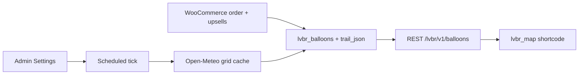

# Design notes

How the plugin works and why, written as the plan while building versions 1.1 to 1.4 and kept up to date where it has changed. For setup and usage see the [README](../README.md); later features (ranking, flight modes, refunds, emails, entry limits, demo race) are described there and in the changelog in [readme.txt](../readme.txt).

Leaflet + OpenStreetMap for the public map. Balloons drift from a configured launch point (or a paid custom launch point). Wind comes from Open-Meteo, fetched per ~11 km grid cell so balloons that spread apart pick up different winds and their paths diverge. Distance per tick scales with the chosen interval, so a 5-minute update is a small hop and a daily update is a long one.

## 1. Settings

Submenu `lvbr-settings`, `manage_options`, Settings API (`register_setting` with one `lvbr_settings` option array, sanitised and clamped).

Fields (defaults in brackets):

- **Auto-update interval:** Off, 5 minutes, 30 minutes, 1 hour, 6 hours, Daily [Off]
- **Base speed (km/h)** [35]
- **Helium multipliers:** Eco-Glide / Balanced / Max Height [0.7 / 1.0 / 1.35]
- **Random variance %** [15]
- **Wind influence** 0–1 [0.6]: how much real wind speed changes the distance (see §3)
- **Default heading** if no weather [70° — roughly where the UK's prevailing south-westerly blows]
- **Launch location:** lat, lng, label [Ashton Court, Bristol]; place-name search via Nominatim (no API key)
- **Weather:** enable Open-Meteo [on]
- **Per-balloon weather** [on]: wind at each balloon's grid cell instead of launch-only
- **Burst rates (per day):** Max Height [5%]; storm burst [10%] when wind ≥ storm threshold [45 km/h] (Balanced + Max Height only; Eco-Glide is immune)
- **Map:** default zoom [7], refresh seconds [60], trail length [80 points]
- **Upsell prices** (see §6): helium strategy [£1], custom launch [£2], logo [£2]; each can be switched off

Help text notes that WP-Cron needs site traffic (or a real system cron) for 5-minute accuracy.

**Burst chance scales with interval.** Rates are stored per day and converted per tick: `p_tick = 1 - (1 - daily_rate) ^ (interval_seconds / 86400)` (≈ `daily_rate * interval/86400` for small values). Five-minute ticks no longer wipe out Max Height balloons.

**Scheduling.** Custom WP-Cron schedules `lvbr_5min`, `lvbr_30min`, `lvbr_6hours` (plus core `hourly`, `daily`). Prefer WooCommerce **Action Scheduler** when `as_schedule_recurring_action` exists; otherwise WP-Cron. Races can override the interval and other movement settings (a `movement` JSON column; blank = Settings). The job runs at the shortest interval of any unfinished race (else the Settings interval), and each race ticks only when its own interval is due (half a run early counts; the end time is always caught up). On settings save, race save or delete: unschedule both, reschedule at that interval. On deactivation: unschedule. A transient lock stops overlapping ticks.

**Manual Advance** on the leaderboard page stays and calls the same tick, simulating N hours [the current interval, or 1 hour if Off]. An optional **min/max km override** remains for event-day control.

## 2. Positions, trails and logos

Schema changes run `dbDelta()` when the stored `lvbr_db_version` is older than the plugin's, so installs upgrade without re-activation. db 1.1.0 added to `{prefix}lvbr_balloons`:

- `latitude` decimal(10,7) NULL, `longitude` decimal(10,7) NULL
- `start_lat` decimal(10,7) NULL, `start_lng` decimal(10,7) NULL
- `logo_attachment_id` bigint(20) unsigned default 0
- `trail_json` longtext NULL — ordered `[lat, lng]` points, capped
- `last_moved_at` datetime NULL

New balloons spawn at their start point (custom launch if bought, else the launch setting) and seed `trail_json` with it. Existing rows with empty coords are placed at the launch point on upgrade (distance kept).

## 3. Tick and movement

Each tick, for every `is_burst = 0` balloon:

1. **Weather:** wind for the balloon's grid cell (per-balloon on) or the launch point. Fallback: launch-point wind, then the default heading with base speed.
2. **Bearing:** Open-Meteo gives the direction wind comes *from*, so travel bearing = `(wind_dir + 180) % 360`, plus a per-tick jitter of ±12° so balloons in the same cell still fan out.
3. **Distance:** `base_kmh * helium_mult * hours * wind_factor * (1 ± variance)`, where `hours` is the tick length shortened by the flight mode (Drift and Soar slow balloons down over the flight with a half-life; Jetstream doesn't)
   - `wind_factor = clamp((1 - w) + w * wind_kmh / base_kmh, 0.25, 2.5)` where `w` is Wind influence, so calm days still move a little and gales don't teleport.
4. `distance_km += step`; new `lat/lng` from the haversine destination formula.
5. Append to `trail_json`, trim to the cap.
6. Burst rolls: Max Height daily rate; storm rate if cell wind ≥ threshold (not Eco-Glide). A burst balloon stops but keeps its trail.

Open-Meteo: `https://api.open-meteo.com/v1/forecast?latitude={lat}&longitude={lng}&current=wind_speed_10m,wind_direction_10m&wind_speed_unit=kmh`.

## 4. Wind grid cache

Never call Open-Meteo once per balloon. Round positions to a 0.1° cell (~11 km) and cache wind speed + direction per cell in a transient for `max(10 min, interval)`. Balloons in the same cell share one request. A failed fetch caches a short "miss" (2 min) so a slow API doesn't stall every tick, then falls back as above. Cap new fetches per tick (e.g. 40) and reuse the launch wind for the rest.

## 5. Map

Shortcode `[lvbr_map height="520px"]` (can sit next to `[lvbr_leaderboard]`).

- Leaflet 1.9.4 (bundled in `assets/vendor/leaflet`) + `assets/js/map.js`, OpenStreetMap tiles with attribution
- Launch flag; balloon-shaped SVG markers in the balloon's colour, with the logo inside the balloon when bought; a popped shape when burst
- Popup: balloon name, owner, colour, distance, status
- Public REST `GET /wp-json/lvbr/v1/balloons`: public fields only (no emails, no order IDs) plus `trail`; sent with no-cache headers so page caches (LiteSpeed) don't serve stale positions
- Polls the REST route every N seconds; updates in place without resetting the view or the selection
- **Trails:** one `L.polyline` per balloon, thin, low-opacity, colour-matched. Selecting a balloon (marker, list, or `?balloon=ID`) makes its trail thick, full opacity, glowing and on top; the marker grows; other trails fade. Clicking the map background clears it.
- Side list of balloons (searchable) to select from
- Burst balloons: grey dashed trail, grey marker
- `[lvbr_leaderboard map_url="/race-map/"]` links each row to `?balloon=ID`; if the map is on the same page, clicking a row selects it directly

## 6. Paid add-ons

On balloon products, alongside the existing name / colour / strategy fields:

| Option | Default price | What it does |
| --- | --- | --- |
| Base entry | product price (e.g. £3–£5) | Single-colour marker |
| Tactical helium strategy | +£1 | Max Height (faster, burst risk) or Eco-Glide (slower, immune to storm bursts). Balanced stays free |
| Custom launch point | +£2 | Search a place or click a mini map to start from a school, hometown, etc. |
| Logo / image | +£2 | Image shown as the balloon's map icon |

- Add-on prices come from Settings and are applied in `woocommerce_before_calculate_totals`; cart lines show each add-on with its price.
- Custom launch lat/lng is validated (range, numeric) and stored on the cart item → order item meta → `start_lat/start_lng`.
- **Logo:** PNG/JPG/WebP, max 1 MB. Handled on add-to-cart with `media_handle_upload` (`test_form => false`, restricted `mimes`), real type checked with `wp_check_filetype_and_ext` / `getimagesize` — never trust the browser's MIME. Attachment ID flows cart item → order item meta → `logo_attachment_id`. Uploads are tagged `_lvbr_logo_upload`; ones never ordered are deleted after 7 days. Needs the standard product form, sent as `multipart/form-data`: AJAX add to cart can't send files, so once a picture is chosen `product.js` stops click and submit events at the window (capture phase) before a theme's AJAX handlers see them, and the form posts normally. A hidden `lvbr_logo_chosen` flag catches anything that still sends the form without the file: add to cart is refused with a message instead of dropping the logo.
- Each upsell can be switched off in Settings.

## 7. Multisite

- All table names via `$wpdb->prefix` (already the case)
- Network activation installs the table on every site; `wp_initialize_site` installs it on new sites
- Settings, cron and transients are per site (standard WP behaviour)
- No hard-coded URLs; assets via `plugins_url`

## 8. Race schedules

A site can schedule several races (usually one at a time). Every balloon belongs to exactly one race, and entries are bought for a specific race.

**Race fields:** name, launch point (lat/lng/label, defaults from Settings), entries open (optional, defaults to "now"), launch time (required), end time (optional; open-ended races run until finished by hand). Times are stored in UTC and shown in the site timezone.

**Stages (worked out from the clock, never stored):**

| Stage | When | Shop | Balloons |
| --- | --- | --- | --- |
| Upcoming | before entries open | closed ("entries open on …") | none yet |
| Entries open | entries open → launch | open | wait at their start point |
| Flying | launch → end | closed | move each tick |
| Finished | after end | closed | frozen; final leaderboard |

**Purchasing**
- Product option "Race": *Any race open for entries* (default) or a specific race.
- Product page: one open race → shown as "Entering: …"; several → buyer picks; none → product is not purchasable and shows when entries next open.
- Race ID travels cart → order item meta → balloon row. Cart/checkout re-checks the race is still open and removes entries for races that have launched.
- An order paid after launch (e.g. a delayed payment) still creates its balloon, starting from the launch point.

**Movement:** each tick moves only Flying races. Each race keeps its own clock (`last_tick_at`), so time is counted from launch and stops at the end time. Manual Advance targets one race.

**Display:** `[lvbr_map race="…"]` and `[lvbr_leaderboard race="…"]` accept an ID, slug or `current` (default: the race that's flying, else the next one taking entries, else the last finished). REST: `GET /lvbr/v1/balloons?race=…`, `GET /lvbr/v1/races`.

**Migration (db 1.2.0):** existing balloons went into an auto-created race using the launch point, launched at the first balloon's purchase time. The old site-wide "Race ends" setting became each race's end time.

## 9. Entry product type, default pages, participant view (db 1.3.0)

**Product type replaces the tick box.**
- New WooCommerce product type **Balloon race entry** (`lvbr_balloon_entry`, class `LVBR_Product_Balloon_Entry` extending the simple product, so themes render it with the simple add-to-cart template). Always virtual; the virtual/downloadable boxes are hidden for it.
- A **Balloon race** tab in Product data holds the race lock (moved off the General tab).
- The "Balloon Entry" tick box, the `balloon-entry` tag and the `lvbr_balloon_product_ids` option/filter are removed. `lvbr_is_balloon_product` stays for developers.
- Migration: simple products with the old tick box or tag become `lvbr_balloon_entry`; the old meta is deleted. Other product types (e.g. variable) can't convert; an admin notice lists them.
- Race form: **Create entry product** makes a draft `lvbr_balloon_entry` product locked to that race and opens it for a price. The race screen lists its linked products.

**Default pages.**
- On activation (and the 1.3.0 upgrade) the plugin creates a **Balloon Race** page if none is set: map, leaderboard and a race list, as shortcode blocks admins can edit.
- **Settings → Pages**: pick the tracking page, **Create missing pages**, and **Regenerate** (resets the content to the default, after a confirm).
- One page serves every race: the shortcodes follow `?race=<slug|id>` when no `race` attribute is set. New `[lvbr_races]` lists races with links.
- The leaderboard's `map_url` defaults to the tracking page.
- **My Account → My balloons** (WooCommerce endpoint `my-balloons`): the user's balloons in every race with rank, distance and a map link.

**Participants see their own balloon.**
- A balloon belongs to a logged-in user if `user_id` matches, or its order belongs to their account (WooCommerce's `customer_id`, which covers guest orders it links to an account). Matching `owner_email` against the account or billing email was dropped in 1.13.0, because those emails aren't verified; the `lvbr_match_balloons_by_email` filter turns it back on.
- Their balloon IDs are added to the page only for logged-in users (logged-in pages aren't page-cached); the public REST payload is unchanged.
- Map: a **My balloons / All** toggle; with no `?balloon=` link, the map opens on the user's balloon. Leaderboard: the user's balloons pinned above the table with their rank, plus the same toggle.
- Guests: order confirmation page and customer order emails get **Track your balloon** links (`?race=…&balloon=…` on the tracking page).

**Search and privacy.**
- Leaderboard search covers the whole race, not just the rows shown (rows past `limit` are rendered hidden and revealed by search).
- Public owner names are always **first name + last initial** ("Luke H."), on the map, leaderboard and REST. The `lvbr_public_owner_name` filter still runs on the result. Search matches the public name only. Admin screens keep full names.

## 10. Teams (db 1.4.0)

Off by default.

**Settings → Teams**
- **Enable teams** (off by default). When off, no team appears anywhere (shop, map, leaderboards, admin), but stored teams are kept.
- **Default teams**: name + colour rows. A new race starts with a copy of this list.
- **Default scoring**: Average distance (default), Total distance, or Best balloon.

**Per race** (race screen, when teams are on)
- The race's own teams: rename, recolour, add, remove (a team with balloons can't be removed). **Add default teams** fills an empty list.
- **Team scoring**: use the default, or pick average / total / best for this race.
- A race with no teams simply doesn't use them.

**Data**
- `{prefix}lvbr_teams` (id, race_id, name, color, sort); `team_id` on balloons; `team_scoring` on races ('' = default).
- Scores: average and total use every balloon's distance (burst balloons count at the distance they reached); best is the furthest balloon. Teams with no balloons rank last.

**Buying**
- When the chosen race has teams, the product page shows a required **Team** select (filtered by race when the buyer picks between races). Validated against the race server-side.
- Team travels cart → order item (shown as "Team") → balloon row.

**Display**
- `[lvbr_teams]`: team standings (rank, team with colour, balloons, score, leading balloon). Added to the default tracking page; a tracking page still on the old default content is updated on upgrade.
- Balloon leaderboard, map list and popups show the team (colour badge); search matches team names.
- Map: a team filter in the side panel (alongside My balloons).
- REST: balloons gain `team`; the payload gains `teams` standings.
- Admin leaderboard and CSV: team column. My Account → My balloons: team column.
